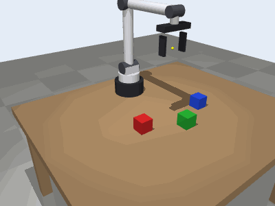

# LLM-controlled robot arm simulator

Type a sentence such as **"stack red on blue"**. A language model (LLM) breaks it
into steps, a safety checker approves or blocks each step, and a simulated
5-joint robot arm carries them out on a table with three coloured blocks.



It is built to be read. Each layer is one short Python file with teaching comments.

| You want to… | Go to |
|---|---|
| Install and run it | this page |
| Understand the code | [docs/WALKTHROUGH.md](docs/WALKTHROUGH.md) |
| Learn the robotics behind it | [docs/COURSE.md](docs/COURSE.md) (8 modules, 1–2 h each) |

## Install (Windows 10/11)

You need Python 3.12 or 3.13 (64-bit). No GPU is required.

1. Install Python 3.13 from <https://www.python.org/downloads/windows/>.
   On the first installer screen tick **"Add python.exe to PATH"**.
2. Open **PowerShell**, go to the project folder, and run these one at a time:

```powershell
cd path\to\llm-robot-arm
```
```powershell
py -3.13 -m venv .venv
```
```powershell
.\.venv\Scripts\Activate.ps1
```
```powershell
python -m pip install -r requirements.txt
```
```powershell
python -m pytest -q
```

The last command runs the automated tests; you should see `18 passed`.

What those lines do: `venv` creates a *virtual environment* (a private folder of
Python packages just for this project, so nothing else on your PC is affected),
`Activate.ps1` switches this PowerShell window to use it (your prompt gains a
`(.venv)` prefix), and `pip install` downloads the exact package versions listed
in `requirements.txt`.

If `Activate.ps1` is blocked with a "running scripts is disabled" error, run this
once in the same window and try again:

```powershell
Set-ExecutionPolicy -Scope Process -ExecutionPolicy Bypass
```

Each time you open a new PowerShell window, repeat the `cd` and `Activate.ps1` lines.

<details><summary>Linux / macOS</summary>

```bash
python3 -m venv .venv && source .venv/bin/activate && pip install -r requirements.txt
```
Headless Linux (no screen) also needs `sudo apt-get install -y libegl1 libosmesa6 libglfw3`.
On macOS the live window needs `mjpython run_demo.py ... --viewer` instead of `python`.
</details>

## Run it

```powershell
python run_demo.py "stack red on blue" --viewer
```

`--viewer` opens a live 3D window (left-drag rotates, right-drag pans, scroll zooms).
Without `--viewer` nothing opens; instead the run is recorded. Either way a folder
appears under `runs\` containing:

- `report.html` — the plan next to what actually happened (open it in a browser)
- `log.jsonl` — the same data for programs
- `run.gif` — a recording (only without `--viewer`)

The same table is printed in the terminal as it runs:

```
 #  PLAN (what was asked for)        CHECK     ACTUAL (what was measured)
 2  grasp(block=red)                 approved  holding red (finger gap 37.8 mm)
 3  place(x=0.24, y=0.12, z=0.06)    approved  red now at (0.242,0.120,0.060), 2.2 mm off
```

More things to try:

```powershell
python run_demo.py --interactive --viewer
```
```powershell
python run_demo.py "put red at 0.6 0.0"
```
```powershell
python run_demo.py "stack green on red on blue" --perception camera
```

The second one asks for a spot the arm cannot reach: watch the validator refuse it.
The third finds the blocks from a camera image instead of reading them from the simulator.

## Using the real LLM

Without an API key the program uses a small **offline stand-in planner** so that
everything else can run and be tested. It only understands these phrasings:

`stack red on blue` · `stack green on red on blue` · `put red at 0.30 0.10` ·
`put red on the table` · `pick up green` · `move to 0.25 0.0 0.15` · `home`

For free-form commands ("tidy up", "make a tower with blue on top") use Claude:

1. Create an API key at <https://platform.claude.com/settings/keys> (usage is billed per
   request; a command is a handful of short requests).
2. In PowerShell, in the same window you run the demo from:

```powershell
$env:ANTHROPIC_API_KEY = "paste-your-key-here"
```
```powershell
python run_demo.py "build a tower with green on top" --viewer
```

Never put the key in a file inside this folder. The model defaults to
`claude-opus-5-5`; pass `--model` to change it.

## The pieces

```
llm-robot-arm/
├── run_demo.py            the program you run; wires the layers together
├── requirements.txt       pinned package versions
├── robot_sim/
│   ├── config.py          every number: link lengths, limits, block size
│   ├── scene.py           (a) physics scene: arm, table, blocks, cameras  [MuJoCo]
│   ├── kinematics.py          joint angles <-> gripper position
│   ├── controller.py      (b) low-level controller: PID + smooth trajectories
│   ├── skills.py          (c) skill library: move_to, grasp, place
│   ├── validator.py           safety checks between the planner and the robot
│   ├── executor.py            the one doorway: validate -> run -> log
│   ├── llm_planner.py     (d) LLM planner (function calling) + offline stand-in
│   ├── perception.py          optional: find blocks from a camera image
│   ├── runlog.py              plan-vs-actual log and HTML report
│   └── viz.py                 live window and GIF recorder
├── stages/                one runnable script per layer, used by the course
├── tests/                 automated tests (python -m pytest -q)
└── docs/                  WALKTHROUGH.md and COURSE.md
```

## What has and has not been verified

Everything below "verified" was actually run while building this (Linux, Python
3.13.18, MuJoCo 4.0.1, CPU only).

**Verified**
- All 18 automated tests pass, including stacking three blocks (each lands within
  8 mm of target and stays upright) and the kinematics agreeing with MuJoCo to
  a millionth of a metre across the workspace.
- Every command shown in this README, the walkthrough and the course was run, and
  the numbers quoted in the docs are the ones those runs printed.
- The live `--viewer` window was run 6 times in a row under a virtual display.
- The pinned packages have installable Windows builds for Python 3.12 and 3.13.

**Not verified**
- **Nothing was run on Windows.** The code avoids platform-specific features, but
  the install steps above are untested on a real Windows machine.
- **The real-LLM path has not made a live API call** (no API key was available
  while building). Its loop is tested against a scripted stand-in that mimics
  the API's replies, and the request was checked against the installed SDK's
  function signature. See the note at the end of `docs/WALKTHROUGH.md` if the
  first live call reports an API error.
- The live viewer on a real display, and on macOS.
